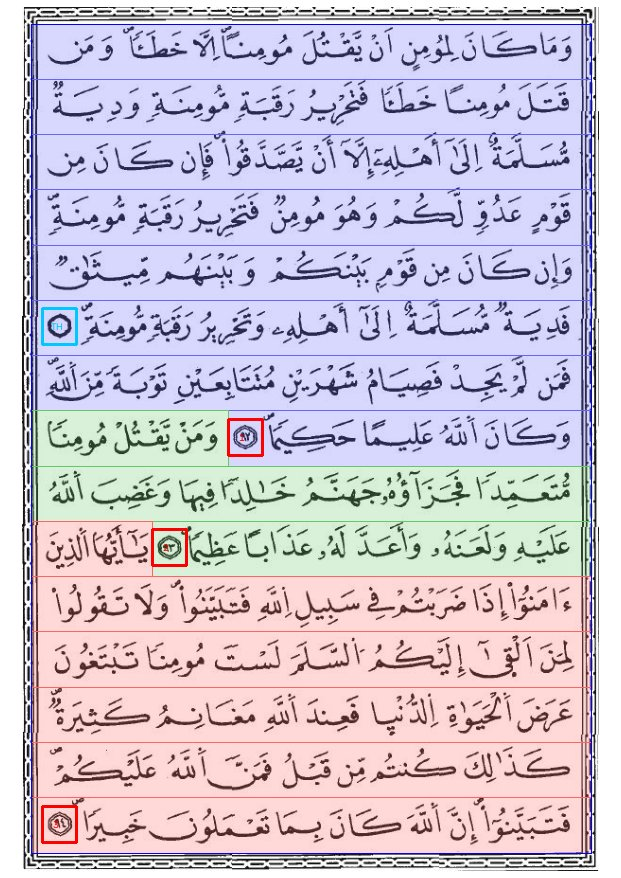
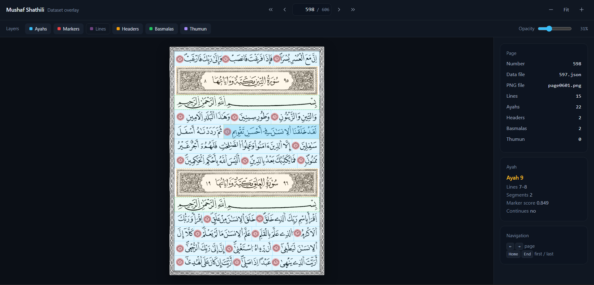

# Al-Shazly Warsh Mushaf: Ayah Masks & Coordinates Dataset | مصحف الشاذلي برواية ورش: إحداثيات ومحددات الآيات القرآنية

[](https://neon-x-hub.github.io/mushaf-shathili-ayah-masks/viewer/)
[](https://github.com/neon-x-hub/mushaf-shathili-ayah-masks/releases/tag/v2.0.0)
[](LICENSE)
[-blue?style=flat-square)](check_surah_ayah_counts.py)

High-precision bounding polygons, line segments, verse markers, and ready-to-render SVG paths for every Ayah in the **Al-Shazly Warsh Mushaf** (Algeria edition, 15 lines/page).

Designed for frictionless integration into Quran mobile apps (**Flutter**, **Android/Kotlin**, **iOS/Swift**) and web apps (**React**, **Vue**, **SVG/Canvas**).

> **Source Mushaf (High-Resolution Edition):** Sourced from [neon-x-hub/mushaf-shathili](https://github.com/neon-x-hub/mushaf-shathili) (`Mushaf-Ashathili.pdf`, 1488 × 2207 high-fidelity scan with uniform 46.23 px borders).
> *Legacy Scan Reference:* Hosted on the [Internet Archive](https://archive.org/details/ALSHTTTTTTTTTTTTTTTTTTTTTARSH/mode/2up) (`ALSHAZLY__ALGZAER__WARSH.pdf`, 621 × 878).

---

## Visual Verification Examples

| **Page 001: Ornamental Opening Frame** | **Page 092: Embedded Thumun (1/8 Hizb)** | **Page 598: Multiple Surah Headers** |
| :---: | :---: | :---: |
|  |  |  |
| *Special 7-line decorative layout, custom rosette markers, top gold header, and isolated emerald Basmala.* | *Hollow Thumun marker (cyan 'TH') distinguished from numbered verse rings and merged into parent verse without splitting.* | *Multiple consecutive Surah headers (gold), separate Basmalas (green), and short Surahs in Juz 'Amma.* |

---

## Dataset Highlights

- **606 Total PDF Pages** processed with streaming PyMuPDF rendering (all 606 pages with active verses).
- **High-Resolution 1488 × 2207 Scan** (5.7× more pixel density than legacy 621 × 878 scan) with uniform 46.23 px border padding on all regular pages (lines 1–15, exact 141.0 px line height without vertical drift).
- **114 Surah Header Banners** automatically detected across lines and cleanly excluded from verse masks (Surahs 1–114, excluding the closing footer on Page 605).
- **112 Basmala Lines** identified directly beneath headers (excluding Surah At-Tawbah on Page 186, and Surah Al-Fatihah on Page 000 where Basmala is counted as Ayah 1) and isolated from verse masks so Ayah 1 of each Surah contains only genuine verse text.
- **13 Hollow Thumun (1/8 Hizb) Markers** identified and merged into their true parent Quranic verses, providing complete verse highlighting while exposing exact Thumun coordinates.
- **6,236 Total Completed Verses** across all 606 pages, perfectly matching the canonical Kufi count across all 114 Surahs with 100.0% verification.
- **100% Native Marker Detection (Zero Manual Fixes)**: The high-resolution scan detects all verse markers directly. **Zero manual missing ayah masks** required (Pages 093 and 329 detected natively), and **zero heuristic predicted end-of-page markers** required (all 16 line-15 bottom-left markers are physically detected with high scores: 0.61–0.86, avg ~0.79).
- **Dedicated Handlers for Opening Pages 000 & 001**: Special 7-line content framing, ornamental header detection, and rosette ring matching using exact calibrated bounding boxes.
- **Resolution-Independent**: Stored both in original page coordinates and normalized ($0.0 \dots 1.0$) coordinates.
- **Ready-to-Render SVG**: Every verse contains pre-computed SVG path strings (`svg_path` and `normalized_svg_path`) for single-element rendering.
- **Interactive Viewer**: Run locally or explore live on [GitHub Pages](https://neon-x-hub.github.io/mushaf-shathili-ayah-masks/viewer/) ([`viewer/index.html`](viewer/index.html)) to interactively inspect and debug verse overlays, segments, markers, headers, and Basmalas across all 606 pages.

---

## Comparison: High-Resolution Scan vs. Legacy Scan

| Feature / Metric | High-Resolution Edition (`Mushaf-Ashathili.pdf`) | Legacy Edition (`ALSHAZLY...WARSH.pdf`) | Accuracy Impact |
| :--- | :--- | :--- | :--- |
| **Page Dimensions** | **1488 × 2207 px** | 621 × 878 px | **+470% pixel area** (clean, crisp calligraphy & markers) |
| **Border Geometry** | **Fixed 46.23 px uniform padding** | Variable margin drift (0.050 / 0.028) | Constant 141.0 px/line, eliminating vertical misalignment |
| **Marker Template Match Score** | **0.80 – 0.86 average correlation** | 0.65 – 0.78 average correlation | Far greater confidence separation between markers & text |
| **Manual Missing Ayah Patches** | **0 required** (100% natively detected) | 2 required (`093_missing_ayah.png`, `329_missing_ayah.png`) | Eliminates manual pixel-drawing hacks |
| **Predicted End-of-Page Markers**| **0 required** (all 16 physical markers detected) | 16 heuristically synthesized markers | All line-15 verse ends are now authentic physical markers |
| **Opening Rosette Markers** | **100% precision (0 false positives)** | Faint detection requiring manual mask guidance | 7/7 on Page 0 and 5/5 on Page 1 detected cleanly |
| **Hollow Thumun Classification** | **13/13 detected with 100% accuracy** | 13/13 detected with lower margin | Center hole contrast is distinct (inner mean 255 vs 196) |

---

## 📦 Downloads & Releases (v2.0.0)

Pre-built dataset archives and the source high-resolution Mushaf PDF scan are available on GitHub Releases:

| Asset | Format / Size | Description | Download Link |
| :--- | :--- | :--- | :--- |
| **`mushaf_ayah_masks.json.gz`** | Gzip JSON (~926 KB / ~15.7 MB uncompressed) | Complete consolidated dataset of all 606 pages, including all verse bounding boxes, segments, markers, and SVG paths. | [**Download (.gz)**](https://github.com/neon-x-hub/mushaf-shathili-ayah-masks/releases/download/v2.0.0/mushaf_ayah_masks.json.gz) |
| **`surah_ayah_mapping.json.gz`** | Gzip JSON (~888 KB / ~16.8 MB uncompressed) | Hierarchical Surah-indexed dataset (Surahs 1–114) tagged with canonical Kufi verification. | [**Download (.gz)**](https://github.com/neon-x-hub/mushaf-shathili-ayah-masks/releases/download/v2.0.0/surah_ayah_mapping.json.gz) |
| **`pages.zip`** | Zip Archive (~1.6 MB) | All 606 individual `output/pages/{page_num}.json` files bundled into a single archive. | [**Download (.zip)**](https://github.com/neon-x-hub/mushaf-shathili-ayah-masks/releases/download/v2.0.0/pages.zip) |
| **`Mushaf-Ashathili.pdf`** | PDF Scan (1488 × 2207) | Official high-resolution source scan of the Al-Shazly Warsh Mushaf. | [**neon-x-hub/mushaf-shathili Releases**](https://github.com/neon-x-hub/mushaf-shathili/releases) |

> 💡 **Repository vs. Release Downloads:**
> - **Individual Pages (`output/pages/*.json`)**: All 606 per-page JSON files are tracked directly in this git repository, allowing web and mobile apps to fetch or stream individual pages on demand via raw GitHub CDN URLs (e.g. `https://raw.githubusercontent.com/neon-x-hub/mushaf-shathili-ayah-masks/main/output/pages/071.json`).
> - **Full Collective Datasets**: For bulk processing, offline database seeding, or full local sync, download the release archives above or visit the [v2.0.0 GitHub Release page](https://github.com/neon-x-hub/mushaf-shathili-ayah-masks/releases/tag/v2.0.0).

---

## Repository Structure

```text
shathili-mushaf/
├── Mushaf-Ashathili.pdf                # Primary High-Resolution Mushaf PDF (Download from upstream releases)
├── assets/
│   ├── template_ring_new.png           # High-res Ayah marker template (71 × 72)
│   ├── template_ring_hollow_bitmask_new.png # High-res bitmask for Thumun marker detection
│   ├── template_surah_header.png       # Surah header banner template (scaled to 1360 × 271)
│   ├── template_rosette_ring.png       # Rosette marker template for opening pages (81 × 81)
│   ├── 000_mask.png                    # Opening frame mask for Page 000 (1488 × 2207)
│   └── 001_mask.png                    # Opening frame mask for Page 001 (1488 × 2207)
├── mushaf_pipeline.py                  # High-performance batch extraction pipeline
├── map_surah_ayahs.py                  # Generates Surah-to-Ayah mapping & tags every Ayah
├── check_surah_ayah_counts.py          # Verification CLI: tests all 114 Surahs against canonical counts
├── generate_all_overlays.py            # Generates visual debug JPEG overlays for all pages
├── package_release.py                  # Packages release archives (.json.gz, pages.zip) for GitHub Releases
├── viewer/
│   └── index.html                      # Interactive web viewer for inspecting overlays
├── output/
│   ├── pages/                          # Per-page JSON files (000.json to 605.json) [tracked in git]
│   │   ├── 000.json
│   │   ├── ...
│   │   ├── 071.json
│   │   └── 605.json
│   ├── overlays/                       # Visual verification JPEG overlays (000.jpg to 605.jpg)
│   ├── mushaf_ayah_masks.json          # Consolidated single dataset [download from Releases]
│   ├── surah_ayah_mapping.json         # Standalone Surah-to-Ayah hierarchical dataset [download from Releases]
│   └── mushaf-masks.d.ts               # TypeScript type definitions
└── README.md                           # Documentation & integration guides
```

---

## Data Schema (`pages/{page_num}.json`)

Each page JSON file is self-contained and formatted as follows:

```json
{
  "page_number": 71,
  "dimensions": { "width": 1488, "height": 2207 },
  "content_bounds": {
    "x_min": 46, "y_min": 46, "x_max": 1442, "y_max": 2161,
    "normalized": { "x_min": 0.0309, "y_min": 0.0208, "x_max": 0.9691, "y_max": 0.9792 }
  },
  "lines_count": 15,
  "ayahs_count": 8,
  "thumun_count": 0,
  "thumun_markers": [],
  "markers_count": 8,
  "headers_count": 0,
  "headers": [],
  "ayahs": [
    {
      "ayah_index": 1,
      "start_line": 1,
      "end_line": 1,
      "is_continuation_to_next_page": false,
      "has_thumun": false,
      "thumun_marker": null,
      "compact_polygons": ["f"],
      "segments": [
        {
          "line": 1,
          "start_pct": 100.0,
          "end_pct": 0.0,
          "x_right_norm": 0.9691,
          "x_left_norm": 0.0309,
          "y_top_norm": 0.0208,
          "y_bottom_norm": 0.0847,
          "pixel_rect": [46, 46, 1442, 187]
        }
      ],
      "pixel_polygons": [
        [[46, 46], [1442, 46], [1442, 187], [46, 187]]
      ],
      "svg_path": "M 46 46 L 1442 46 L 1442 187 L 46 187 Z",
      "normalized_svg_path": "M 0.0309 0.0208 L 0.9691 0.0208 L 0.9691 0.0847 L 0.0309 0.0847 Z",
      "marker": {
        "cx": 103, "cy": 120, "w": 71, "h": 72,
        "cx_norm": 0.0692, "cy_norm": 0.0544,
        "line": 1, "score": 0.8212,
        "is_predicted": false,
        "is_hollow": false,
        "type": "ayah"
      }
    }
  ]
}
```

### Key Properties

| Property | Type | Description |
| :--- | :--- | :--- |
| `svg_path` | `string` | SVG multi-polygon path command `M x y ... Z`. Drop directly into `<path d={ayah.svg_path} />`. |
| `normalized_svg_path` | `string` | Resolution-independent SVG path scaled to $0.0 \dots 1.0$. Use with SVG `viewBox="0 0 1 1"`. |
| `segments` | `Array` | Line-by-line bounding coordinates (normalized and pixels) for Canvas or Flutter painting. |
| `has_thumun` | `boolean` | `true` if this verse contains an unnumbered hollow Thumun (1/8 Hizb) marker inside it. |
| `thumun_marker` | `Object \| null` | Coordinates of the Thumun marker inside this verse (`cx`, `cy`, `line`, etc.). |
| `thumun_markers` | `Array` | Page-level list of all hollow Thumun markers found on the page. |
| `basmalas` | `Array` | Bounding boxes and SVG paths for Basmala lines (`line`, `pixel_rect`, `svg_path`). |
| `headers` | `Array` | Surah header bounding boxes and covered 2-line span (`start_line`, `end_line`, `has_basmala`). |
| `compact_polygons` | `Array` | Industry-standard compact notation (`"f"` for full line, percentage strings for margins). |
| `marker` | `Object` | Pixel and normalized center coordinates of the verse end ring marker. |
| `is_continuation_to_next_page` | `boolean` | `true` if this segment represents verse text at the bottom of the page that continues onto the next page. |

---

## Quick Integration Guides

### 1. React / Next.js / Web (Using SVG Overlay)

```tsx
import React, { useState } from 'react';

interface MushafPageViewProps {
  pageImageUrl: string;
  pageData: {
    dimensions: { width: number; height: number };
    ayahs: Array<{ ayah_index: number; svg_path: string }>;
  };
}

export function MushafPageView({ pageImageUrl, pageData }: MushafPageViewProps) {
  const [selectedAyah, setSelectedAyah] = useState<number | null>(null);
  const { width, height } = pageData.dimensions;

  return (
    <div style={{ position: 'relative', width: '100%', maxWidth: width }}>
      {/* Background Mushaf Page */}
      

      {/* SVG Mask Overlay */}
      <svg
        viewBox={`0 0 ${width} ${height}`}
        style={{ position: 'absolute', top: 0, left: 0, width: '100%', height: '100%' }}
      >
        {pageData.ayahs.map((ayah) => {
          const isSelected = selectedAyah === ayah.ayah_index;
          return (
            <path
              key={ayah.ayah_index}
              d={ayah.svg_path}
              fill={isSelected ? 'rgba(251, 191, 36, 0.45)' : 'rgba(56, 189, 248, 0.1)'}
              stroke={isSelected ? '#f59e0b' : 'transparent'}
              strokeWidth={1.5}
              style={{ cursor: 'pointer', transition: 'all 0.15s ease' }}
              onClick={() => setSelectedAyah(ayah.ayah_index)}
            />
          );
        })}
      </svg>
    </div>
  );
}
```

---

### 2. Flutter (`CustomPainter`)

```dart
import 'package:flutter/material.dart';

class AyahHighlightPainter extends CustomPainter {
  final List<AyahSegment> segments;
  final Rect pageRect; // Bounding rect on screen
  final Color highlightColor;

  AyahHighlightPainter({
    required this.segments,
    required this.pageRect,
    this.highlightColor = const Color(0x55FBBF24),
  });

  @override
  void paint(Canvas canvas, Size size) {
    final paint = Paint()
      ..color = highlightColor
      ..style = PaintingStyle.fill;

    for (final seg in segments) {
      final left = pageRect.left + (seg.xLeftNorm * pageRect.width);
      final right = pageRect.left + (seg.xRightNorm * pageRect.width);
      final top = pageRect.top + (seg.yTopNorm * pageRect.height);
      final bottom = pageRect.top + (seg.yBottomNorm * pageRect.height);

      final rrect = RRect.fromRectAndRadius(
        Rect.fromLTRB(left, top, right, bottom),
        const Radius.circular(4),
      );
      canvas.drawRRect(rrect, paint);
    }
  }

  @override
  bool shouldRepaint(covariant CustomPainter oldDelegate) => true;
}
```

---

## Pipeline Usage & Re-generation

The extraction pipeline runs directly in memory using `PyMuPDF` and `OpenCV`.

### Run for all 606 pages:
```bash
python mushaf_pipeline.py --output output
```

### Generate visual verification overlays for all 606 pages:
```bash
python generate_all_overlays.py
```

### Run for a specific page range with visual verification overlays:
```bash
python mushaf_pipeline.py --start 70 --end 75 --save-overlays --output output
```

### CLI Arguments:
- `--pdf`: Path to Mushaf PDF (default: `Mushaf-Ashathili.pdf`).
- `--template`: Path to marker ring template (default: `template_ring_new.png`).
- `--hollow-bitmask`: Path to hollow bitmask (default: `template_ring_hollow_bitmask_new.png`).
- `--header-template`: Path to surah header template (default: `template_surah_header.png`).
- `--output`: Output directory (default: `output`).
- `--start`: Start page index (default: `0`).
- `--end`: End page index (default: `-1` for all pages).
- `--threshold`: Match threshold (default: `0.50`).
- `--save-overlays`: Render visual `.jpg` overlays into `output/overlays/`.
- `--no-overwrite`: Skip pages that already have JSON files generated.

---

## Interactive Overlay Viewer

An interactive web viewer is provided in [`viewer/index.html`](viewer/index.html) to visually inspect and debug Ayah bounding masks, segments, marker rings, Surah headers, Basmalas, and Thumun markers against the high-resolution Mushaf page scans across all 606 pages.

### 🌐 Live Online Viewer (GitHub Pages)

You can access and test the viewer directly in your browser without local setup:

👉 **[Launch Online Mushaf Overlay Viewer](https://neon-x-hub.github.io/mushaf-shathili-ayah-masks/viewer/)**

*(Direct URL: `https://neon-x-hub.github.io/mushaf-shathili-ayah-masks/viewer/`)*



### Running the Viewer Locally

Because the viewer fetches the page JSON files dynamically (from `output/pages/*.json`), it must be served over HTTP rather than opened directly via `file://`.

Run a local HTTP server from the root of the repository:

```bash
# Using Python
python -m http.server 8000
```

or with Node.js:

```bash
# Using npx serve / http-server
npx serve .
```

Then open your browser at:
```text
http://localhost:8000/viewer/index.html
```

### Viewer Features:
- **Layer Toggles**: Switch Ayahs, Segments, Markers, Headers, Basmalas, and Thumun indicators on or off.
- **Overlay Opacity & Zoom**: Fine-tune transparency and zoom in/out or fit to screen.
- **Interactive Inspector**: Hover or click any Ayah to view its metadata (lines, segments count, marker score, continuation flag).
- **Keyboard Navigation**: Use <kbd>←</kbd> and <kbd>→</kbd> arrow keys to navigate pages, or <kbd>Home</kbd> / <kbd>End</kbd> to jump to the first or last page.

---

## 📄 License
Distributed under the **[MIT License](LICENSE)**. Free for community, commercial, research, and educational use in all Islamic applications.
